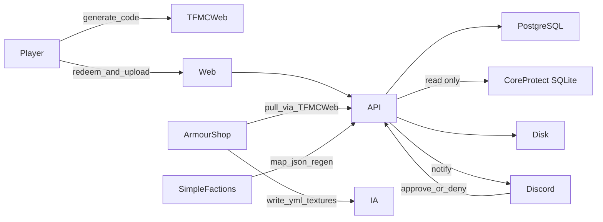

# Architecture

Shape of the **TFMC platform**: modular website hub plus SimpleFactions (map), ArmourShop/ItemsAdder (skins), DrinkBuilder (drinks), and tfmc_bot (Discord).

Component journeys: [flows/journeys.md](flows/journeys.md). Dev-only flags: [ops/dev-config.md](ops/dev-config.md).

## Current stack (`main` branch)

| Layer | Tech |
|-------|------|
| Frontend | Next.js (App Router), React, Tailwind - production Docker (`npm run start`) |
| Backend | FastAPI + Uvicorn, Pillow mapgen, PostgreSQL 17 (all site records) |
| Deploy | `docker-compose.yml` - backend `:8000`, frontend `:3000` |
| Data | Per-map folders under `input/`, `defines/`, generated `output/`; PostgreSQL volume for records; `backend/src/data/` for uploads |

```text
SimpleFactions (plugin)
        │  POST queue / upload JSON, GET regenerate
        ▼
FastAPI ── mapgen/regiongen ──► backend/src/output/{map}/…
        │  skins / drinks / characters / identity APIs
        ▼
Next.js  ◄── hub, /map, /profile, /character
```

- Generators **do not** write into `frontend/public`.
- Assets served by [`backend/src/api/file_routes.py`](../../backend/src/api/file_routes.py).
- Paths centralized in [`backend/src/scripts/util/dirs.py`](../../backend/src/scripts/util/dirs.py).

## Product shape

```text
tfminecraft.net/
  /              Hub (brand, nav, short intro, links into modules)
  /map/[mapId]   Interactive maps
  /profile       Characters, skin and drink wardrobes, custom items, linked accounts
                 ?tab=skins&skin=new upload, &skin=<id> status (drinks alike)
                 ?tab=characters&character=<id> sheet, &view=kits its kits
  /character/*   Character creator, kit item editor, wardrobe (/character redirects to /profile)
  /admin         Staff player, activity, rail and permission tools
  /map/editor    Staff map title editor (?map= required)
```

Backend stays FastAPI. Frontend stays Next.js. New capabilities are **modules** (routes + routers + data), not more logic stuffed into `MapViewer`.

## System diagram



| Actor | Responsibility |
|-------|----------------|
| **Web (Next)** | UX: hub, map, skins, drinks, character forms; talks to API |
| **API (FastAPI)** | Map pipeline + cosmetics modules + contracts for bot / plugins |
| **PostgreSQL** | Accounts, codes, submissions, Characters, snapshots and audit |
| **Disk** | Map `output/`; pending skins under `backend/src/data/skins/` |
| **Discord bot** | Skins/drinks approve/deny; ban/warn DMs; Discord banned-role mute |
| **TFMCWeb** | Mint UUID-bound codes; Discord link; plugin gateway to the API |
| **ArmourShop** | Pull approved via TFMCWeb; write `tfmc_submissions` + category YAML |
| **SimpleFactions** | Map upload / province lookup / regen only |
| **ItemsAdder** | Serves pack content ArmourShop wrote |

## Frontend routes

| Path | Role |
|------|------|
| [`frontend/app/page.tsx`](../../frontend/app/page.tsx) | TFMC hub landing |
| [`frontend/app/map/[map]/page.tsx`](../../frontend/app/map/[map]/page.tsx) | Dynamic map route, including `main` and `r3b1rth` |
| [`frontend/app/components/profile/ProfileItems.tsx`](../../frontend/app/components/profile/ProfileItems.tsx) | Skin upload and brew form, and their status, inside Profile's tabs |
| [`frontend/app/character/`](../../frontend/app/character) | Character creator + kits + wardrobe |
| [`frontend/app/diagnostic/`](../../frontend/app/diagnostic) | Unlisted player diagnostic ([ops/diagnostic.md](ops/diagnostic.md)) |
| [`frontend/app/map/editor/`](../../frontend/app/map/editor) | Staff map title editor |
| [`frontend/app/components/MapViewer.tsx`](../../frontend/app/components/MapViewer.tsx) | Map composer |
| [`frontend/app/components/shell/SiteHeader.tsx`](../../frontend/app/components/shell/SiteHeader.tsx) | Shared nav |

API base: `process.env.NEXT_PUBLIC_API_URL`.

### Loading states

[`LoadingSkeleton.tsx`](../../frontend/app/components/shared/LoadingSkeleton.tsx) provides reusable content, article, form, list, table, map, model and chart outlines using Profile's muted placeholder blocks. Each loading view announces one status message; accompanying outlines and preview thumbnails are decorative and hidden from assistive technology. The pulse animation uses `motion-safe` so reduced-motion preferences keep the outlines still.

App Router `loading.tsx` boundaries cover route navigation, with outlines suited to the map, gameplay guide, updates, staff panel and character pages. Client components use the same skeletons while their initial data or previews load. The live wardrobe keeps its slot frames non-interactive until the saved slots arrive, then shows placeholders while their previews load. Background refreshes retain the previous results where available. Upload, export, generation and server-action progress continue to show their task-specific feedback.

## Backend API (high level)

| Area | Examples |
|------|----------|
| Map | `map_routes`, `data_routes`, `file_routes`, `regen_routes` |
| Skins | codes, redeem, upload, staff review, plugin approved |
| Drinks | redeem, submit, catalog, staff review |
| Characters | session, create, roster, wardrobe, web entitlements (`PUT /characters/plugin/rpc-player-meta`) |
| Profile | dashboard, skin/drink start, code sign-in (`POST /profile/redeem`), code wardrobe (`GET /profile/wardrobe`) |
| Identity | Discord link, guild grace |
| Diagnostic | Server ping, resource pack copy, speed test, player reports |

Map regen auth: hashed key on claim/regen routes. Cosmetic routes use session tokens / plugin keys. See [identity/auth-security.md](identity/auth-security.md).

## Frontend modules

```text
frontend/app/
  layout.tsx              Shared shell: nav, fonts, atmosphere
  page.tsx                Hub
  map/[map]/page.tsx      Thin wrapper → MapViewer
  components/
    shell/                Header, footer, nav
    map/                  MapViewer split over time
    profile/              Tabs, wardrobes, skins and drinks opened in a tab
    skins/                Upload form, status card
```

Rules:

- One shared layout; map is a **page**, not the whole site.
- Map performance work stays inside map components/hooks.
- New tools get a route + component folder; they do not import MapEngine.
- Skins UI enforces [cosmetics/naming.md](cosmetics/naming.md) before upload.

## Backend modules

```text
backend/
  server.py                 App + CORS + router include
  src/api/
    map_*.py / file_*.py    Map surface
    skins_routes.py         Codes, upload, status, staff actions, plugin pull
    drinks_routes.py        Drink submissions and catalog
  src/database/
    connection.py           Native PostgreSQL pool and transactions
    migrations/             Ordered, checksummed PostgreSQL schema
  src/skins/
    db.py                   Asset directory paths and initialization
  src/data/skins/           Runtime files (gitignored)
  src/scripts/…             Mapgen
```

Map and cosmetics share Docker and process space but not business logic.

## Data stores

### PostgreSQL (site records)

`DATABASE_URL` points to the site's Compose `db` service and persistent volume.
Startup applies checked, ordered migrations from `backend/src/database/migrations/`.
Configuration, migrations, backups and restores: [PostgreSQL storage](ops/postgresql.md).

| Table family | Purpose |
|--------------|---------|
| `login_codes`, `code_sessions` | In-game codes and the sessions they open |
| `skin_submissions` | Skins workflow |
| `drink_submissions`, `drink_textures`, `drink_catalog` | Drinks workflow |
| `discord_links`, `discord_link_codes` | Identity |
| `player_notifications` | Bot outbox for Discord DMs to players: staff warnings and bird mail |
| `war_declaration_codes` | War declaration codes |
| Character sessions, roster, creation requests (`character_creation_requests`, `character_creation_wardrobe`), wardrobe, wills and catalog | Characters API |
| `web_entitlements` | Per-realm rank entitlements from TFMCWeb: character limit, name colours, wardrobe slots, skin kinds, drink perks, permission flags |
| `character_account_meta` | Per-account data from RPCharacters' roster push: 18+ answer, account creation time, kit cooldowns |
| `users`, `user_sessions`, OAuth states | Website accounts and sign-in |
| Patreon and LuckPerms tables | Entitlement state and plugin outboxes |
| Chronicle and Ledger index tables | Map history indexes |

### Filesystem

```text
backend/src/data/skins/{submission_id}/   # pending skin blobs + meta.json
backend/src/output/{map}/                 # generated map assets
```

Map assets remain under `backend/src/output/{map}/…`. PNGs stay on disk for serving and pack export.
CoreProtect is a separate read-only SQLite source.

## Auth model

| Surface | Mechanism |
|---------|-----------|
| Account and staff panel | Discord OAuth and HttpOnly browser session; website staff roles |
| Map plugin regen / queue | Shared secret in path (prefer env) |
| Skins/drinks/character player actions | Redeem **code** → short-lived Bearer session tied to issuer UUID |
| Skins staff (Discord) | Server-side staff API key; never `NEXT_PUBLIC_*` |
| Skins/drinks ArmourShop/DrinkBuilder pull (via TFMCWeb) | Plugin secret; only **approved** payloads |
| Staff map / editor | Profile Bearer session + `tfmc.map.staff` permission flag |

No website passwords. Codes are **not shareable by design**: cosmetics are granted to the **issuer UUID** only. Full hardening details: [identity/auth-security.md](identity/auth-security.md).

## Where details live

| Topic | Doc |
|-------|-----|
| Map SF ↔ API ↔ web | [integrations/simplefactions.md](integrations/simplefactions.md) |
| ArmourShop + `tfmc_submissions` | [integrations/armourshop.md](integrations/armourshop.md) |
| tfmc_bot skins + ban role | [integrations/discord-bot.md](integrations/discord-bot.md) |
| Patreon supporter roles + ranks | [integrations/patreon.md](integrations/patreon.md) |
| Full journeys | [flows/journeys.md](flows/journeys.md) |
| Naming | [cosmetics/naming.md](cosmetics/naming.md) |
| TFMCWeb identity | [identity/tfmcweb.md](identity/tfmcweb.md) |

## Non-goals

- Rewriting mapgen in another language
- Putting Discord or Java plugins inside TFMCWeb git (document contracts only)
- Manual `tfmc_pack` CMD overrides for new submissions
- Bot executing in-game bans
