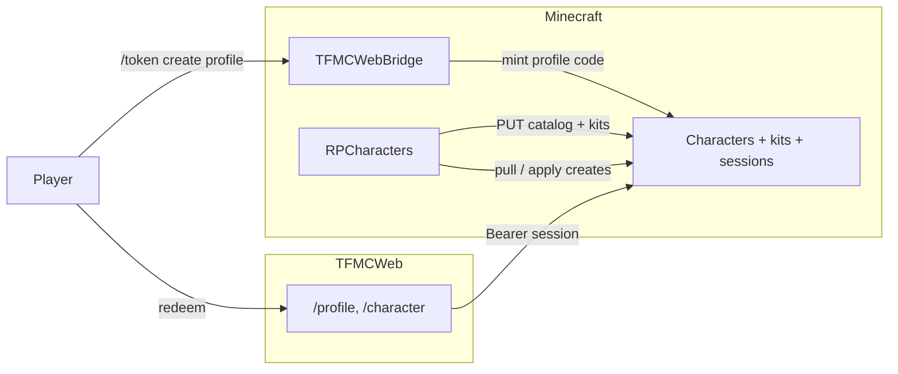

# Character creator

Web + RPCharacters character creation, kits, lore customise, and wardrobe.

**Repos:** `rpcharacters/` · `TFMCWeb` · `tfmcweb/` · `frontend` · (kits) `armourshop/`

**Depends on:** TFMCWeb identity + `/token create profile` ([identity/tfmcweb.md](../identity/tfmcweb.md)).

## Why

Donators (and later all players) create and manage RP characters on the website with the **same rules as in-game** `/rpcharacter create` / menu. Creation stages sync from the server so YAML edits update the site after reload. Auth stays **in-game tokens** (no website accounts).

## Character creation

### Auth

| Decision | Choice |
|----------|--------|
| Proof of account | In-game `/token create profile` (UUID-bound, Discord-eligible); redeem at `/profile` |
| Code lifetime | Consumed **on redeem** |
| After redeem | API **session** Bearer - **8h** (the site offers no Remember me) |
| Storage | sessionStorage |
| Website accounts | **None** |

### Attribute point-buy

| Rule | Value |
|------|-------|
| Attributes | strength, dexterity, constitution, intelligence, wisdom, charisma |
| Pool | **12** points - must spend exactly 12 |
| Max rank per attribute at creation | **4** in `stages.yml`; rank 4 alone costs 15, so 12 points buy at most rank **3** |
| Cost for *n*-th rank in one attribute | **2^(n-1)** points (1, 2, 4, 8) |
| Sync | Formula + caps exported in creation catalog |
| Character view | Each attribute bar has five segments split across that attribute's ceiling: the best race, affordable rank and trait picks the catalogue allows, honouring mutual exclusions across stages |

Personality / physical / celestial / story traits stay **selection** stages.

The attribute sheet shows purchased ranks, the combined race/trait modifier, and
the resulting total (with a minimum of zero). Only purchased ranks consume the
point-buy pool and are sent in the create request.

### Creation catalog sync

RPCharacters on enable/reload **PUT**s a full-replace snapshot to TFMCWeb (stage order, options, validation rules, slot limits, attribute formula). Web **GET**s snapshot for the wizard.

The character view reads the synced `background`, which holds the in-game lore of the character's
`background-trait-types` choices, and matches it line by line against catalogue trait descriptions.
Homeland, cataclysm, reclamation and motivation show as cards under Story; the other choices join the
trait tags, with their lore on hover. A `<Race>:` line in a trait's lore starts that race's version, which
only characters of that race see. Lines no trait matches show as prose under Background.

### Characters API + ownership

| Concern | Owner |
|---------|--------|
| Source of truth for living characters | **RPCharacters** |
| Web sessions / create requests | **TFMCWeb** Characters API |
| Apply web creates into RPC | RPCharacters pull/ingest |
| Identity + mint | TFMCWeb + Discord link |

### Applying web creates

RPCharacters checks each pending create against the in-game creation rules before it writes the
character ([CreationRules](https://github.com/TF-Minecraft/RPCharacters/blob/main/src/main/java/net/tfminecraft/rpcharacters/creation/CreationRules.java)).
A create that fails is rejected, and the Profile shows the reason on the rejected card.

| Check | Rule |
|-------|------|
| Name | Starts with a letter in any alphabet, then letters, spaces, apostrophes, hyphens and full stops; `persona.yml` display-name length; no colour codes |
| Race | Offered by a web race stage |
| Age and birthday | From `calendar.yml` `age.minimum` to the race's `age-max` |
| Class | A displayed MMOCore base class |
| Description | `config.yml` description length |
| Traits | Each trait exists and belongs to a web stage that opens for this character (stage dependency and account age). Per stage: pick count, points and the `permanent-only` filter. Attribute ranks run in order up to the max rank and spend the whole pool. No mutually exclusive pair, and each trait's requirements and account-age playtime are met |
| Clues | At least the character's required count, at most `max-clues`, clue length from `config.yml`, no repeats (ignoring case) |
| Slots | Online owner: their rank limit. Offline owner: their rank limit read from LuckPerms with this server's contexts. When LuckPerms cannot be read, the create stays pending for the next pull |

Gender and name colours are not checked when applying. TFMCWeb checks name uniqueness on submit,
and RPCharacters trims name colours to the rank's limit at login.

TFMCWeb runs the same name, race age, trait and clue checks on `POST /characters`
([creation_rules.py](../../../backend/src/characters/creation_rules.py)),
so the wizard shows the problem instead of the create being rejected later. Pending creates count
towards the slot limit, and the create page says so when every slot is taken. The website takes the limit from
the player's TFMCWeb entitlements (`web_entitlements`); a player TFMCWeb has never synced gets the catalogue's
default limit. In the wizard, a trait
whose requirement is missing cannot be picked, and picks are dropped when their stage closes or their
requirement goes, for example evil archetypes once the personality that unlocks them is removed.

When a create has wardrobe skins, the wizard sends it with `hold: true`, uploads the skins, then calls
`POST /characters/creates/{id}/release`. RPCharacters does not see a held create until it is released
or 10 minutes pass, so a closed tab still delivers the character, without the missing skins.

### Product / UI

| Decision | Choice |
|----------|--------|
| Nav | **Character** tab beside Map and Skins |
| Landing | Session → list characters (alive + dead); CTA to create if free slot |
| Create | Multi-step wizard from synced stages |
| Slots | Enforce synced limits (default 3; Gilded 4; Ascended/Legacy 5; hard cap 10) |
| Dual path | In-game `/rpcharacter create` remains; RPCharacters checks web creates against the in-game rules before applying them |

The wizard summary includes gender, birthday, name colours, wardrobe selections
(slot, chosen name or filename, and arm model), and attribute totals including
race/trait modifiers. A masked skin generated from the base is identified as such.
Each Edit link opens the corresponding step. Displayed and submitted birthdays use
the calendar settings from the catalogue.

Before submission, the wizard rechecks all currently available steps. Invalid
steps have Review links and block creation until corrected; this includes an age
that exceeds the maximum after changing race. Hidden stages, including an already
answered 18+ question, do not block submission.

## kits (summary)

Configurable kits in `plugins/RPCharacters/kits.yml`:

| Rule | Choice |
|------|--------|
| Claim command | `/rpcharacter kit <kitId>` with that character **active** |
| Cooldown | **Per kit** (player UUID × kit id) |
| Once per character | Per kit `once-per-character: true|false` |
| Sync | All kit defs + per-character status → TFMCWeb |

## kit item customise (summary)

Customise **editable** kit lines on the website (Profile → character → Kits → Customise). Texture via player skins pipeline → `ps_items`; lore via RPCharacters. Block claim while skin pending approval or slug missing on ArmourShop.

The character's **Kits** card opens `/profile?tab=characters&character=<id>&view=kits`
inside the Characters tab: each kit's state (claimed or not, once per character or its
cooldown), the claim command while it can be claimed, and its items with their amounts.
Item names come from the kit, the item preview, or the config path in title case.
Editable items in an unclaimed kit have **Customise**; customised items show their
state chip and **View**, which opens them in Custom items. Source:
[`ProfileKits.tsx`](../../../frontend/app/components/profile/ProfileKits.tsx).

Profile's **Custom items** tab (`/profile?tab=items`) lists every customised kit item
from `GET /profile` (`custom_items`, each with its `kit_id`) as cards with the item's
skin, else the kit's default texture. A card opens the item in the tab
(`&item=<character id>/<kit key>`): the picture, the character and kit, its state, the
in-game tooltip (kit lore, a gap, then the player's lines) and **Edit item** while the
kit is still claimable and no skin is in review. The item's details come from
`GET /characters/kits`. Source:
[`ProfileCustomItems.tsx`](../../../frontend/app/components/profile/ProfileCustomItems.tsx).

**Kit uploads:** new textures (or book covers / 3D model) on editable kit items use **character login only** — no skin mint token. Picking an already-**applied** skin from your account pick list also does not consume a mint token. Standalone skins from Profile's [Skins tab](../cosmetics/skins.md#profile-wardrobe) still need a skin code (**New skin** or `/token create skin`).

Applied skins appear in the kit editor pick list and can be attached to any character with the same `base_set`.

Editable templates: `2d-template` (required), optional `3d-template`. Book journals use kind `book` (unsigned + signed PNGs).

## wardrobe (summary)

| Concern | Choice |
|---------|--------|
| Slots | `base` + `masked` + up to 2 extras by rank |
| PNG | **64×64 only**; MineSkin v2 sign |
| Apply | Join, character switch and a 45s refresh while online; `/rpcharacter wardrobe` in-game |
| Web | Standing frames; modal preview. New uploads can be equipped and edited at once; a **Syncing** chip shows until RPCharacters applies them |
| Profile | The list's portraits come from `GET /characters/{id}/face` and the character view's 16×32 front view from `GET /characters/{id}/figure` (arms follow the slot's saved model). `GET /profile` gives each living or pending character `worn_skin`, the worn slot's name or null, shown on the Wardrobe link. All three read the worn slot without enforcing slot limits; `GET /characters/{id}/wardrobe` does enforce them, deleting skins in locked slots, so Profile never calls it |

Separate from item skins and RP identity masks.

## Architecture

## Out of scope

- Website passwords / OAuth
- Rewriting non-attribute selection stages into sheets (unless redesigned later)

Operator checklist: [STAGING.md](../../STAGING.md).
