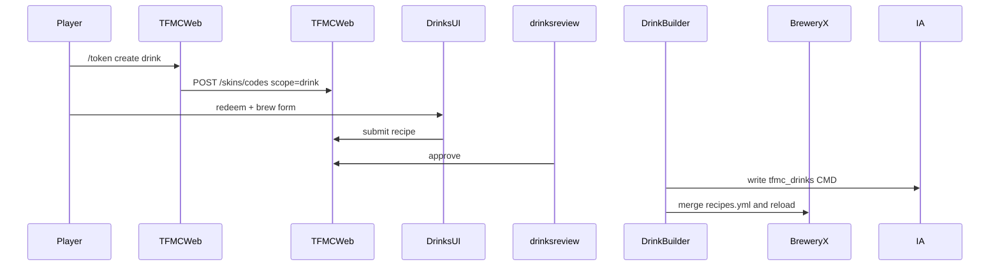

# Drink Builder (BreweryX)

End-to-end design for donator **custom BreweryX recipes**: token → website brew form → Discord review → DrinkBuilder writes ItemsAdder `tfmc_drinks` (optional texture) + merges `recipes.yml`.

**Status:** Code **shipped**. Operator staging smoke in [STAGING.md](../../STAGING.md).

**Repos:** `drinkbuilder/` · `tfmcweb/` · `TFMCWeb/` · `tfmc_bot/` · ItemsAdder `tfmc_drinks` · BreweryX

**Related:** [cosmetics/skins.md](skins.md) · [identity/tfmcweb.md](../identity/tfmcweb.md) · [flows/journeys.md](../flows/journeys.md)

## Goals

- Curated ingredient allowlist in DrinkBuilder synced to the site.
- Optional custom potion PNG → IA `tfmc_drinks` with forced CMD; BreweryX `customModelData` matches.
- Texture **reuse** across drinks (refcount); staff delete without orphaning shared skins.
- **Shared mint cooldown** skin↔drink owned by **TFMCWeb**.

## Locked product rules

| Rule | Choice |
|------|--------|
| Start | **New drink** on `/profile?tab=drinks` (`POST /profile/drinks/start`), or `/token create drink` → scope `drink`, redeemed under the Drinks tab's Use a code or at [Profile sign-in](skins.md#signing-in-with-a-skin-or-drink-code). Same rules as skins: [Profile wardrobe](skins.md#profile-wardrobe) |
| Shared cooldown | Skin + drink share one clock; cooldown days come from TFMCWeb config, synced as `skin_token_cooldown_days` |
| Noble | Can mint drink; **color-only** (no custom texture upload/reuse) |
| Gilded+ | Can upload texture **or** reuse an existing owned drink texture |
| Ingredients | Allowlist in DrinkBuilder `ingredients.yml`; sync catalog to PS/web |
| Texture base | Vanilla **potion** + CMD - never paper |
| IA namespace | **`tfmc_drinks`** |
| Color xor texture | Color-only **or** custom texture, not both |
| Review | One Discord submission = recipe + optional texture / color sheet |
| Delete | `/drinkbuilder drink delete <id>`; remove recipe; free IA texture only if refcount = 0 |

## Rank ladder (mint + texture)

| Rank | Shared cooldown | Mint drink | Custom texture |
|------|-----------------|------------|----------------|
| defaults | disallowed | no | no |
| Noble | 28 days | yes | no (color only) |
| Gilded | 21 days | yes | yes |
| Ascended | 14 days | yes | yes |
| Legacy | 7 days | yes | yes |

## High-level flow

## Data (TFMCWeb)

- `drink_submissions` - recipe JSON, status, player UUID, optional texture
- `drink_textures` - owner UUID, `custom_model_data` (DrinkBuilder's route and payload call it `cmd`), IA id, refcount, png path
- `drink_catalog` - ingredients allowlist + category labels + effects blacklist
- `drink_notifications` - staff/bot outbox

**API (`/drinks`):** redeem · submit · catalog · staff pending/approve/deny · plugin catalog. Drink entitlements (`allow_drink_texture`, `allow_drink_message`, name colours) come from TFMCWeb via `PUT /characters/plugin/rpc-player-meta` and are stored in `web_entitlements`.

## Plugin surface (DrinkBuilder)

| Command | Role |
|---------|------|
| `/drinkbuilder reload` | Reload config + re-push catalog + assets |
| `/drinkbuilder catalog sync` | Push ingredients + categories + blacklist to PS |
| `/drinkbuilder pack pull [force]` | Pull approved → IA + Brewery merge + ack |
| `/drinkbuilder drink delete <id>` | Remove recipe; free CMD iff refcount 0 |

## Website

- Profile Drinks tab: cards with the potion in the drink's colour, or the drink's own texture from `GET /drinks/submissions/{id}/texture` (owner only; the upload, else the shared `drink_textures` file it reuses), review state and New drink
- Brew editor at `/profile?tab=drinks&drink=new` and the drink's page at `&drink=<id>`, inside the Drinks tab; `/drinks` redirects to the tab for the in-game code message
- A drink's page shows the potion beside its name, alcohol and difficulty, review state, the in-game tooltip with lore, then ingredients (catalogue names), brewing steps (cook, distil, age and barrel), effects, colour and dates ([`DrinkShowcase.tsx`](../../../frontend/app/components/profile/DrinkShowcase.tsx))
- Session key `tfmc_drinks_session`; gate texture UI on `allow_drink_texture`
- Recipe fields: name, ingredients, cooking/distill, lore, effects, message/title, glint, color **xor** PNG/reuse
- PNG: 16×16 potion icon

## Discord

`drinksreview` cog polls `/drinks/staff/pending`, posts recipe embed + review sheet, Approve/Deny; player DMs via drink notifications outbox. See [integrations/discord-bot.md](../integrations/discord-bot.md).

## Out of scope

- Migrating every hand-authored Brewery recipe to IA fruit tokens
- Player-authored servercommands
- ArmourShop writing drinks
